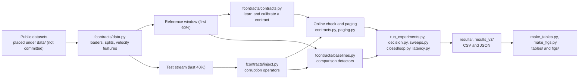

# Feature contracts: reproduction package (v3)

Rebuilt from the manuscript text on public data only. Reproduces the paper's
tables on the credit card (cc), credit card plus velocity (ccv) and default of
credit card clients (default) datasets, and runs the frozen-configuration
confirmation on IEEE-CIS and Bank Account Fraud.

## How the package fits together

Conceptual workflow diagram of the code in this repo. It shows no data and no results.



## Data (never commit data files)

Put the files under `data/`:

| Dataset | File | Source |
| --- | --- | --- |
| cc, ccv | `data/creditcard.csv` | OpenML or Kaggle `mlg-ulb/creditcardfraud` (284,807 rows, 492 frauds) |
| default | `data/default of credit card clients.xls` | UCI dataset 350 (30,000 rows, 6,636 defaults); `UCI_Credit_Card.csv` also works |
| ieee | `data/ieee/train_transaction.csv` | Kaggle competition `ieee-fraud-detection` (590,540 rows) |
| baf | `data/baf/Base.csv` | Kaggle `sgpjesus/bank-account-fraud-dataset-neurips-2022` (CC BY-NC-ND 4.0; 1,000,000 rows) |

## Setup

```bash
python3 -m venv venv && source venv/bin/activate
pip install -r requirements.txt      # pinned versions; Python 3.13
```

Tested with Python 3.13, NumPy 2.5, pandas 3.0, scikit-learn 1.9. IEEE-CIS needs
about 6 GB of memory; the others under 2 GB.

## Run (reproduces every table and figure in the manuscript)

```bash
sh run_public.sh        # v2 results for cc, ccv, default (decision table, budget sweeps)  -> results/
sh run_v3.sh            # v3 benchmark, closed loop, sensitivity, temporal windows        -> results_v3/
python3 paging_sim.py   # controlled paging simulation                                    -> results_v3/paging_sim.json
python3 sweeps.py --dataset baf  --seeds 0 1 2 --prevalence 0.1 --out results_v3
python3 sweeps.py --dataset ieee --seeds 0 1 2 --prevalence 0.1 --out results_v3
python3 refresh.py --dataset ieee --out results_v3
python3 latency.py --out results_v3
python3 analysis_v3.py                     # -> results_v3/summary_v3.json
sh run_v3_ext.sh        # post-confirmation analyses: exact conformal, adaptive calibration, closed loop with recovery
sh run_v3_ext2.sh       # correlated (lineage-group) faults and ten extra fault seeds
python3 adaptive.py --dataset ieee --discrete-max 10 --out results_v3
python3 overhead.py --out results_v3       # check time and contract size on each dataset
python3 make_tables.py --out tables        # every results table as LaTeX
python3 make_tables_ext.py --out tables    # tables for the post-confirmation analyses
python3 make_figs.py --out figs            # every figure
```

Approximate run times on a 2-core laptop: public datasets about 1 hour; IEEE-CIS about 3 hours; Bank Account Fraud about 1 hour.

## Seeds and preprocessing

Fault seeds 0-4 (one random window start per seed after a 5,000-request burn-in); decision and closed-loop seeds 0-2;
default-credit rows shuffled with seed 0. String columns are encoded as categories. Velocity and per-card aggregates
exclude the current request. Splits: first 60% reference (80% fit, 20% calibration), last 40% test.

## Confirmatory and exploratory analyses

The frozen configuration (`fcontracts/config.py`, hashed before each confirmation) is unchanged by the
post-confirmation analyses; they add options (`calibration="conformal1"`, the `group_*` operators,
`--discrete-max`) that default to off. Code files were extended after the confirmations, so the recorded hashes identify the code as it was frozen, not the current files.

## Confirmation hashes

`results/code_hashes_ieee_freeze.txt` (v2 configuration, before IEEE-CIS was loaded) and
`results_v3/code_hashes_baf_freeze.txt` (v3 configuration, before Bank Account Fraud was read).

## Files

| File | What it does | Paper |
| --- | --- | --- |
| `fcontracts/contracts.py` | Learning, calibration (grid or conformal), online check, rate checks | 4.1-4.5 |
| `fcontracts/paging.py` | Per-feature Shiryaev-Roberts and CUSUM tests, exact and event-driven | 4.6 |
| `fcontracts/inject.py` | Eight corruption operators plus a NaN fill | Table 1 |
| `fcontracts/baselines.py` | Schema, min-max, auto-profiled, robust z, isolation forest, PCA, conformance, PSI | 5.3 |
| `fcontracts/data.py` | Loaders, splits, velocity and per-card features | 5.1 |
| `fcontracts/config.py` | Frozen configuration (written to `frozen_config.json`) | 5, 7.1 |
| `run_experiments.py` | Fault-injection benchmark, clean-stream false flags and pages | 6.1-6.5 |
| `decision.py` | Clean, corrupted, masked, masked with mask-specific threshold, fallback | 6.6, 6.8 |
| `sweeps.py` | Budget sweep (Figure 3) and severity tier (Table 9) | 6.2, 6.7 |
| `latency.py` | Per-request cost at 100, 1,000 and 10,000 features | 6.4 |
| `analysis.py` | Tables, Wilcoxon with Holm, bootstrap intervals | 6, Table 11 |
| `closedloop.py` | Closed loop: page -> fallback response, decision costs, unnecessary fallback | 6.5 |
| `sensitivity.py` | Fault duration and intermittent persistence | 6.4 |
| `temporal.py` | Rolling-origin temporal windows | 6.6 |
| `refresh.py` | Exploratory periodic contract refresh (IEEE-CIS) | 6.6 |
| `paging_sim.py` | Controlled simulation: per-violation vs burst-aware paging | 6.3, App. B |
| `conformal_eval.py` | Exact single-score conformal calibration vs the two-step rule; exchangeable control | 4.2, 6.8 |
| `adaptive.py` | Drift-aware calibration by online quantile tracking; fault absorption | 6.8 |
| `closedloop_ext.py` | Closed loop with faults that clear: recovery, rule-based responses, cost-optimal threshold | 6.6 |
| `overhead.py` | Monitoring overhead per dataset | 6.10 |
| `analysis_v3.py`, `make_tables.py`, `make_tables_ext.py`, `make_figs.py` | Summary, LaTeX tables and figures | all |
| `tools_conformal_and_dropout.py` | Conformal margin, realized-rate bound, dropout model helpers | 4.2 |

## Differences from the paper's original code

This package was rebuilt from the manuscript, so details the text leaves open
were filled in and are listed here: window start per seed (one random start per
seed in the test stream after a 5,000-request burn-in); scale factor 1,000;
inconsistency noise of one reference standard deviation; Wilson bounds at 95%;
unseen categories get an evidence exceedance of 10; PCA reconstruction keeps
90% of variance; rate thresholds are the larger of the binomial tail and a
margin times the largest fitted window count, chosen per feature.
